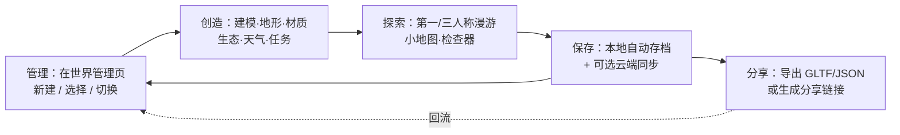

# ForgeVerse · 概念文档（精简版）

> 版本 v0.1 · 文策渊（Vince Coyer） · 供评审，未定稿
> 范围：Phase 1（进入流程重做）+ Phase 2（全屏世界管理 / 多世界存档）

## 1. 定位：工具优先，游戏性为辅

ForgeVerse 是一个**本地优先的 3D 造物工作台**，不是关卡制游戏。用户来这里是为了把脑子里的场景做出来、走进去看看、存下来、以后接着改。建模、布尔、地形、绘画、生态、天气、漫游是主菜；XP、等级、任务是配菜——只提供轻量目标感和进度反馈，**不设失败状态、不设数值惩罚、不因任务未完成而阻断任何创作**。

一句话定义：**一个让创作成果可以被收藏、被切换、被带走的世界工作台。**

本轮改版的重心不在"多一个玩法"，而在"把入口从一次性弹窗，改成可长期经营的世界资产总览"。

## 2. 核心循环：创造 → 探索 → 管理 → 分享

四个环节的用户价值：

| 环节 | 用户动作 | 解决的问题 | 承载界面 |
|---|---|---|---|
| 管理 | 新建、命名、排序、切换、删除世界 | "我上次做的那个在哪" | 全屏世界管理页（本轮新增） |
| 创造 | 搭物体、雕地形、涂材质、配生态天气 | "把它做出来" | 3D 工作台（现有） |
| 探索 | 走进去漫游、定位物体、看小地图 | "做得到底对不对" | 漫游模式（现有） |
| 分享 | 导出 GLTF/JSON、云同步、分享链接 | "怎么留下 / 给别人看" | 存档面板 + 管理页（部分本轮新增） |

**关键判断**：管理是循环的入口与枢纽，不是附属页面。旧流程把"选生态 + 起名字"塞进一次性弹窗，导致每次进入都要重做一遍决定，且看不到已有成果——这正是本轮要修的根问题。

## 3. MDA 分析

### Mechanics（机制，引擎已具备）
- **形体机制**：基础/高级几何体、布尔并/差/交、细分、镜像、线性/环形/网格阵列、挤出。
- **表面机制**：顶点绘画（圆/方/星笔刷、柔边、擦除）、纹理画布、12 种 PBR 材质预设、程序化 PBR 贴图（颜色/法线/粗糙度）。
- **世界机制**：种子化高度图地形、地形雕刻与 6 色涂装、动态水面、生态场景、植被散布、9 种天气、昼夜滑块、无限地图（种子分块 + 导航书签）。
- **交互机制**：第一/三人称漫游、小地图、6 标签物体检查器、标签/★标记/一键定位。
- **反馈机制**：XP / 等级 / 成就 / 任务列表、侧栏闲置自动收起。
- **持久化机制**：本地存档（当前为单一 localStorage 键）、自选文件保存/读取、GLTF 导出、GLB/GLTF 导入、腾讯云同步。

### Dynamics（动态，运行中产生的行为）
- **迭代式塑造**：搭一块 → 走进去看 → 退出来改。探索是创造的校验手段，不是独立玩法。
- **世界收藏行为**：用户会同时经营多个题材（草原、雪原、赛博……），并反复切换。这是"多世界独立存档"的真实需求来源。
- **种子复现行为**：地形种子让用户能重现喜欢的基础地形，再在此基础上分化出不同世界。种子应作为可配置项暴露，而非藏在内部。
- **配置前置行为**：用户在进入创作前，希望一次把"名字、生态、天气、时段、画质"定好，避免进来后反复切面板。

### Aesthetics（美学目标）
- **主导美学**：掌控感与完成感（Sensation of mastery / Fulfillment）——所见即所得，成果可留存。
- **视觉基调**：Q 版简约、精致、高画质；界面层级清晰，视觉重点留给 3D 视窗。（具体视觉由 art-director 负责，本文只约束信息层级与留白原则）
- **情绪曲线**：管理页 = 平静、有序、有成就陈列感；工作台 = 专注、沉浸、零干扰；保存/同步 = 安心、可预期。
- **要避免的调性**：工具说明书感、弹窗打断感、满屏技术参数。

## 4. 设计支柱（4 条，用于后续所有取舍）

| # | 支柱 | 含义 | 违反示例（评审时据此判不合格） |
|---|---|---|---|
| P1 | **所想即所见** | 创作动作即时反映在视窗里；配置一次到位，不打断 | 进入后还要连开三个面板才能看到地形 |
| P2 | **世界即资产** | 每个世界是独立、可命名、可切换、可迁移的档案；互不污染 | 切换世界时上一个世界的地形/物体残留 |
| P3 | **管理先行，创作无扰** | 进入先给全局总览；一旦进入工作台，管理入口退到边缘 | 每次打开都弹一次性选择框，遮住已有成果 |
| P4 | **本地优先，云端可选** | 离线完整可用；云同步是增强项，不成为前置条件 | 未登录就不能新建世界 / 无法保存 |

## 5. 范围分层

### MVP（本轮必须交付，缺一不可）
- 全屏世界管理页替代小弹窗，作为进入后的第一屏。
- 多世界独立存档：新建、列表、点击进入、返回、切换互不干扰。
- "新建世界配置"细分项：世界名、生态场景、地形种子、初始天气、时段、画质档、初始物体包、云同步开关（详见 `UX_SPEC.md`）。
- 世界卡片 3 种排布：网格 / 列表 / 时间轴。
- 删除冗余文案（清单见 `UX_SPEC.md` 第 7 节）。
- 空状态、加载态、保存状态的文案与行为。

### 应做（Should，本轮尽量覆盖）
- 筛选（生态 / 云同步状态）与排序（最近打开 / 名称 / 创建时间）。
- 云端同步状态指示与冲突的用户侧处理流程。
- 键盘可达性与移动端触屏适配要点落地。
- 世界卡片操作：重命名、复制世界、删除（含二次确认）。

### 可做（Could， backlog，不进本轮验收）
- 世界模板（空场景 / 演示场景一键开局）。
- 分享链接与缩略图预览。
- 世界标签 / 收藏夹。
- 存档导入导出在管理页的批量入口。

### 不做（Won't，本轮明确排除）
- 账号体系改造、多人实时协同编辑。
- 任务/等级系统的玩法重做。
- 付费、资源交易、经济系统。

## 6. 玩家心理映射

- **自我决定论（SDT）**
  - 自主（Autonomy）：世界名、生态、种子、天气、时段、画质、物体包均可自定义 → 满足"这是我的世界"。
  - 胜任（Competence）：XP/等级/成就提供可见进度；种子与预设降低起步门槛 → 满足"我能做出来"。
  - 联结（Relatedness）：导出 GLTF、云同步、未来的分享链接 → 满足"能被别人看见"。（本轮仅保留通道，不扩张）
- **Bartle 类型**：以**创作者（Achiever/Creator 混合）**为主，探索者次之。因此设计要优先保障"表达的自由度"和"成果的可保存性"，社交与竞争元素暂不投入。

## 7. 设计红线（本项目具体化）

- **认知过载**：新建配置细分项分两组呈现（"身份与场景" / "开局设定"），单屏可见，高级项默认折叠。八项铺满一屏即判违规。
- **主导策略**：云同步不得成为"最优必选"——本地存档与云存档在功能上等价，避免"不开同步就落后"的隐性强制。
- **经济失衡**：本项目无虚拟经济，此项转化为"存储配额透明"——云同步的容量/上限须明示，不得静默失败。
- **支柱漂移**：任何新功能若要求用户在创作中被迫回到管理页确认，视为违反 P3，需重新设计。

## 8. 待决事项（需 team-lead / engineering-lead 对齐）

1. **生态命名不一致**：入口用 `grass/snow/desert/cyber`，`biomes.js` 实际注册 `desert/snow/urban`。建议统一为一套枚举（建议 `grass/snow/desert/cyber`），由 engineering-lead 在架构层拍板并给映射表。
2. **存档键迁移**：现为单一 `forgeverse_v1`。多世界方案需要新键结构（如 `forgeverse.worlds.v1` + `forgeverse.activeWorld.v1`），并给出旧存档的迁移策略（自动迁移为第一个世界 / 提示用户选择），需 engineering-lead 确认。
3. **云同步冲突的服务端语义**：CloudBase 侧的 `updatedAt` 是否可信（服务端时间）、是否提供版本号，决定冲突提示能否准确。待架构文档明确。
