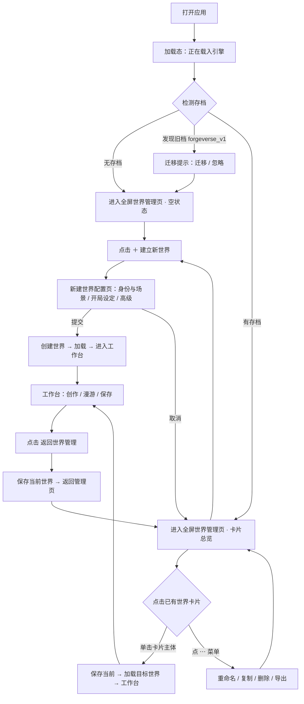

# UX 规格 · 进入流程 / 全屏世界管理页 / 新建配置

> 版本 v0.1 · 文策渊（Vince Coyer） · 供评审，未定稿
> 关联：`CONCEPT.md`、`WORLD_SYSTEM_GDD.md`
> 视觉风格由 art-director 负责；本文只定义**流程、信息架构、状态与文案**。

---

## 0. 需求理解与待确认

- 用户原话"点击'建立新世界'先进入**全屏世界管理页**"——本文理解为：**应用入口不再直接弹选择框，而是先落到一个全屏的世界管理页**；页内主按钮为"＋ 建立新世界"，进入新建配置。这样"先总览、再决定"的意图成立。
- 若用户本意是"点建立新世界后仍要再经一层管理页"，需调整流程节点 ②→③ 的顺序。**请 team-lead 向用户确认一次。**

---

## 1. 完整用户流程图



**关键节点说明**

| 节点 | 名称 | 进入条件 | 退出去向 |
|---|---|---|---|
| ① | 加载态 | 打开应用 | 管理页（空/总览） |
| ② | 全屏世界管理页 | 加载完成、从工作台返回、配置取消 | 配置页 / 工作台 |
| ③ | 新建世界配置页 | 点"＋ 建立新世界" | 工作台（提交）/ 管理页（取消） |
| ④ | 工作台 | 创建成功 / 打开已有世界 | 管理页（返回） |
| ⑤ | 切换加载 | 点已有世界卡片 | 工作台 |

- **首次进入**（无存档）：直接落到 ② 的空状态，主行动是"＋ 建立新世界"。
- **返回不丢状态**：从 ④ 返回 ② 前先保存（§4 保存态），用户在管理页看到的世界卡片更新时间立即刷新。

---

## 2. 全屏世界管理页 · 信息架构

### 2.1 区域划分与层级

```
┌──────────────────────────────────────────────────────────┐
│ L0 顶栏：ForgeVerse  我的世界（N）        [导入存档] [设置]│
├──────────────────────────────────────────────────────────┤
│ L1 主行动：  ＋ 建立新世界      ← 视觉最重，常驻左上      │
├──────────────────────────────────────────────────────────┤
│ L3 工具条：[网格|列表|时间轴]  筛选▾ 排序▾ 搜索  视图⇄   │
├──────────────────────────────────────────────────────────┤
│ L2 世界区：                                              │
│  ┌────────┐ ┌────────┐ ┌────────┐ ┌────────┐             │
│  │缩略图  │ │缩略图  │ │缩略图  │ │缩略图  │  ...        │
│  │世界名  │ │世界名  │ │世界名  │ │世界名  │             │
│  │生态·时间│ │生态·时间│ │生态·时间│ │生态·时间│             │
│  │同步徽标│ │同步徽标│ │同步徽标│ │同步徽标│             │
│  └────────┘ └────────┘ └────────┘ └────────┘             │
├──────────────────────────────────────────────────────────┤
│ L4 状态条：本地存储用量 ▰▰▱▱▱   云同步概览   [导出全部]  │
└──────────────────────────────────────────────────────────┘
```

| 层级 | 区域 | 内容 | 设计意图 |
|---|---|---|---|
| L0 | 顶栏 | 品牌、页面标题"我的世界"、世界总数、导入存档、设置 | 定调，不抢主行动 |
| L1 | 主行动区 | "＋ 建立新世界"大按钮 | 进入即知道能做什么 |
| L3 | 工具条 | 排布切换、筛选、排序、搜索 | 收在卡片上方一行，避免干扰 |
| L2 | 世界区 | 世界卡片 / 新建占位卡 | 内容主体，留白充足 |
| L4 | 状态条 | 存储用量、同步概览、导出全部 | 轻量，替代被删的冗余文案（非重复说明） |

**卡片信息密度**：每张卡只放 4 项——缩略图、世界名、副信息（生态 · 相对时间）、同步徽标。操作收进 ⋯ 菜单，不常驻。

### 2.2 三种排布方案

| 排布 | 默认？ | 交互规则 | 适用场景 | 不适用 |
|---|---|---|---|---|
| **网格（Grid）** | ✅ 默认 | 卡片等宽（桌面 4 列 / 平板 3 列 / 手机 2 列）；单击打开世界；hover 抬升 + 显示 ⋯；方向键在网格内移动焦点 | 世界数 ≤ 12；以缩略图辨识为主；快速视觉扫读 | 世界很多时滚动长；需要比对文本信息时 |
| **列表（List）** | 否 | 行式表格；列 = 世界名 / 生态 / 最近打开 / 体积 / 同步状态 / ⋯；点击行打开；表头可排序；键盘友好 | 世界数 > 12；按名称/时间查找；键盘与读屏用户 | 缩略图辨识弱；视觉陈列感低 |
| **时间轴（Timeline）** | 否 | 按 `openedAt` 分组（今天 / 本周 / 更早）；节点为小卡片，横向（桌面）或纵向（移动端）排列；节点旁显示相对时间 | 找回"上次做的那个"；按创作节奏回顾；叙事化陈列 | 精确查找某个名字；大量世界时节点密集 |

**通用规则**
- 排布选择持久化到用户偏好，下次进入沿用。
- 切换排布时保留筛选、排序与滚动位置的语义等价物（如网格中部 → 列表对应条目）。
- 工具条中的"新建"入口在三种排布下均常驻可达（网格：首位占位卡；列表：首行；时间轴：顶部节点）。

### 2.3 筛选与排序

- 筛选：生态（草原/雪原/沙漠/赛博）、同步状态（已同步/待同步/冲突/未开启）。
- 排序：最近打开（默认）、名称 A→Z、创建时间、体积。
- 搜索：按世界名即时过滤，空结果显示"没有匹配的世界"+ 清除筛选按钮。

---

## 3. 新建世界配置页（细分项清单）

**呈现原则**：分三组，单屏可见；高级组默认折叠。八项铺满一屏即判认知过载（CONCEPT 红线）。

### 组 A · 身份与场景

| 项 | 控件 | 默认值 | 说明 |
|---|---|---|---|
| 世界名 | 文本输入框（美观大字，placeholder"给世界起个名字"） | `未命名世界 N` | 1–24 字符；失去焦点时若为空则回落默认名 |
| 生态场景 | 4 张选项卡片（草原 / 雪原 / 沙漠 / 赛博），单选 | 草原 | 卡片带缩略预览 + 一句场景描述；选中态描边 + 角标 |
| 初始地形种子 | 数字输入 + "换一个"随机按钮 | 随机 1–999999 | 支持手动输入复现地形 |
| 初始天气 | 卡片/下拉（晴 / 雨 / 雪 / 雷暴 / 浓雾 / 极光 / 沙暴 / 多云 / 薄雾） | 晴 | 与引擎现有 9 种对齐 |
| 时段（daytime） | 滑块 0–1，标注"午夜—正午—午夜" | `0.55` | 对齐现有 `timeSlider/100` |

### 组 B · 开局设定

| 项 | 控件 | 默认值 | 说明 |
|---|---|---|---|
| 画质档位 | 4 段选择（流畅 / 标准 / 高清 / 电影级） | 标准 | 对齐现有 4 档 |
| 初始物体包 | 三选一：空场景 / 基础包 / 演示场景 | 基础包 | 空=纯地形；基础=少量起点物体；演示=完整示例 |
| 云同步 | 开关 + 一行说明 | 关 | 本地优先；关闭不禁用任何本地功能 |

### 组 C · 高级（默认折叠，点击"更多设定"展开）

| 项 | 控件 | 默认值 | 说明 |
|---|---|---|---|
| 地形起伏度 | 滑块 | 引擎默认 | 对应 `terrain.height` |
| 地形分辨率 | 分段选择 | 引擎默认 | 对应 `terrain.seg` |
| 起始视角 | 三选一：俯瞰 / 地面 / 漫游起点 | 俯瞰 | "新世界初始界面"细粒度项 |
| 工作台初始面板 | 两选一：侧栏展开 / 侧栏收起 | 侧栏收起 | 减少进入时的视觉噪声 |
| 初始交互模式 | 选择 / 漫游 | 选择 | 直接进入可编辑状态 |
| 环境细节 | 水面 / 网格 / 雾 / 粒子 开关 | 跟随引擎默认 | 对齐 `App.settings` |

**提交行为**：校验世界名 → 创建 World（GDD §3）→ 写入配置快照 → 加载世界 → 进入工作台（④）。按钮文案"创建并进入 →"。取消返回管理页，不产生任何世界。

---

## 4. 状态与反馈（文案 + 行为）

文案原则：说人话、说清"现在怎样"和"能做什么"，不写技术细节。

| 状态 | 出现时机 | 文案 | 行为 |
|---|---|---|---|
| 空状态 | 无世界 | 标题"还没有世界" / 正文"建一个，开始你的第一块地形。" / 按钮"＋ 建立新世界" | 只显示主行动；不显示工具条筛选 |
| 引擎加载态 | 打开应用 | "正在载入引擎…" | 进度指示；不显示"无需联网"类说明（见 §5） |
| 世界加载态 | 打开/切换世界 | "正在打开「世界名」…" | 遮罩 + 进度；失败则回滚（GDD §5.2） |
| 保存中 | 自动/手动保存进行中 | 状态条"保存中…" | 不阻塞操作；防抖 1.5s |
| 已保存 | 保存成功 | 状态条"已保存 · 10:03" | 2s 后淡出；卡片更新时间刷新 |
| 待同步 | 云同步开启但未上传 | 徽标"待同步" | 联网后自动重试；可手动"立即同步" |
| 同步中 | 上传/下载进行中 | 徽标"同步中…" | 不阻塞编辑 |
| 已同步 | 同步成功 | 徽标"已同步 · 10:03" | — |
| 冲突 | 双端均有改动 | 模态"两个版本都有改动" + 时间对比 + 三按钮"用本地 / 用云端 / 另存为新世界" | 不自动覆盖；任一选择后刷新徽标 |
| 错误 · 存储满 | 配额耗尽 | "存储已满，请先删除世界或导出备份。" + 按钮"导出为文件" | 阻止写入，数据不丢 |
| 错误 · 网络 | 云同步失败 | "暂时连不上云端，已保存在本地。" + "重试" | 落到"待同步"，本地可用 |
| 错误 · 加载失败 | 世界快照损坏 | "这个世界打不开了。" + "返回管理页 / 导入备份" | 不修改数据；提供逃生通道 |

---

## 5. 冗余文案删除清单

| # | 位置 | 现有文案 | 处理 | 替换 / 去向 |
|---|---|---|---|---|
| 1 | `index.html:432` intro 底部 tip | 引擎已内置本地，无需联网。所有创作自动存于浏览器，可随时导出 GLTF。 | **删除** | 不替换。信息下沉到设置页与状态条，不占首屏 |
| 2 | `index.html:436` loading tip | Three.js 已内置，无需联网 | **删除** | 加载态只保留"正在载入引擎…" |
| 3 | `index.html:423` intro 说明 | 选择初始生态环境，工作台会据此生成地形与天空基调。 | **改写** | "选一个起点，随时都能改。"（若配置页分组标题已表达，则直接删） |
| 4 | `index.html:422` intro h1 | 🌍 新建你的世界 | **替换** | 管理页标题"我的世界"；新建入口"＋ 建立新世界" |
| 5 | `index.html:430` 世界名称行 | 世界名称 + 默认值"未命名世界" | **替换** | 美观输入框，placeholder"给世界起个名字"，默认"未命名世界 N" |
| 6 | `index.html:431` 按钮 | 开始建造 → | **替换** | 配置页提交按钮"创建并进入 →" |

> 说明：需求明确要求删除冗余文案。上述 #1/#2 为纯删除；#3–#6 属流程改版后的自然替换，不属于"新增强调文案"。

---

## 6. 交互细节

### 6.1 卡片状态

| 状态 | 表现 |
|---|---|
| 默认 | 缩略图 + 4 项信息；边框低对比 |
| 悬停（桌面） | 卡片上浮 4px、阴影加深、露出 ⋯ 菜单按钮；缩略图上叠加"打开"提示 |
| 选中（用于批量/菜单操作） | 主色 2px 描边 + 右上角勾选角标；单击卡片主体仍为"打开世界" |
| 焦点（键盘） | 清晰 `:focus-visible` 外圈；Tab 顺序：新建 → 工具条 → 卡片 → 状态条 |
| 加载中 | 卡片骨架屏，不显示错位信息 |

### 6.2 键盘可达性

- `Tab` 遍历；`Enter` 打开卡片 / 触发按钮；方向键在网格内移动焦点。
- `Delete` 在聚焦卡片上触发删除二次确认；`Esc` 关闭任意模态/菜单。
- ⋯ 菜单可通过 `Shift+F10` 或菜单键呼出。
- 所有交互元素有可见焦点环；颜色对比达到 WCAG AA（由 art-director 落实具体色值）。

### 6.3 移动端适配

- 无 hover：轻触卡片=打开；**长按 400ms** = 呼出 ⋯ 操作菜单。
- 触摸目标 ≥ 44×44px；网格手机 2 列 / 平板 3 列。
- 时间轴改为纵向；配置表单改单列，滑块加大触控热区。
- 工具条在窄屏折叠为"视图"按钮 + 筛选抽屉，避免挤占卡片区。

---

## 7. 验收标准（对应用户 6 条需求）

### R1 选项式界面（原弹窗改选项卡片）
- **AC-1.1** 世界名输入框为大字号美观输入，placeholder"给世界起个名字"，默认"未命名世界 N"。（可截图比对）
- **AC-1.2** 四生态以选项卡片呈现，单选，选中态有描边与角标，hover/点击反馈正常。
- **AC-1.3** "建造/新建"入口按钮相较旧版更小更顺滑，尺寸与圆角符合 art-director 规范，点击无卡顿。
- **AC-1.4** 进入流程中不再出现小弹窗 `#intro` / `#themePick`（DOM 中可保留但默认不显示）。

### R2 全屏世界管理页 + 多排布
- **AC-2.1** 点击入口后首先进入全屏世界管理页（非弹窗），占满视窗。
- **AC-2.2** 提供网格/列表/时间轴三种排布，切换后卡片内容与徽标一致，选择被持久化。
- **AC-2.3** 管理页含 L0–L4 五个区域：顶栏、新建入口、工具条、世界区、状态条。
- **AC-2.4** 筛选（生态/同步状态）与排序（最近打开/名称/创建时间/体积）可用且结果正确。

### R3 独立存档与隔离
- **AC-3.1** 可创建 ≥3 个世界，全部显示在管理页。
- **AC-3.2** 在世界 A 放置物体/改天气，切到 B 不存在，切回 A 仍在（与 GDD A2 一致）。
- **AC-3.3** 单击卡片进入对应世界；返回管理页后卡片更新时间刷新。
- **AC-3.4** 新建与已有世界互不影响：新建不会清空或覆盖已有世界。

### R4 细粒度初始配置
- **AC-4.1** 配置页含组 A/B/C 共 13 个细分项，组 C 默认折叠。
- **AC-4.2** 各配置项默认值符合本文 §3，修改后生效于新世界（种子、天气、时段、画质、物体包、云同步等）。
- **AC-4.3** 高级项（起始视角、工作台初始面板、初始模式、环境细节）影响进入工作台后的初始呈现。

### R5 删除冗余文案
- **AC-5.1** 本文 §5 中 #1、#2 文案在页面中完全消失（全文检索无匹配）。
- **AC-5.2** #3–#6 已按替换文案呈现，无旧文案残留。

### R6 Q 版简约精致高画质（设计层约束）
- **AC-6.1** 管理页信息层级为 L1 主行动 > L2 卡片 > L3 工具条 > L4 状态条，主行动视觉最重。
- **AC-6.2** 首屏无技术术语堆砌；卡片区留白充足，3D 视窗在工作台中不被管理 UI 遮挡。

**验收点合计：19 条**（R1×4 + R2×4 + R3×4 + R4×3 + R5×2 + R6×2），供 quality-lead 编写测试用例。

---

## 8. 待确认（交 team-lead）

1. §0 流程理解：入口 → 全屏管理页 → 页内"建立新世界" → 配置页，是否符合用户本意？
2. "初始物体包"三档（空/基础/演示）的"基础包"具体内容由谁定？建议 engineering-lead 给一组轻量默认物体。
3. 时间轴排布按 `openedAt` 还是 `createdAt` 分组？本文默认 `openedAt`，可按用户偏好改为可切换。
4. 高级配置项中"工作台初始面板"是否与现有 4s 自动收起逻辑冲突，需 engineering-lead 确认可覆盖。
