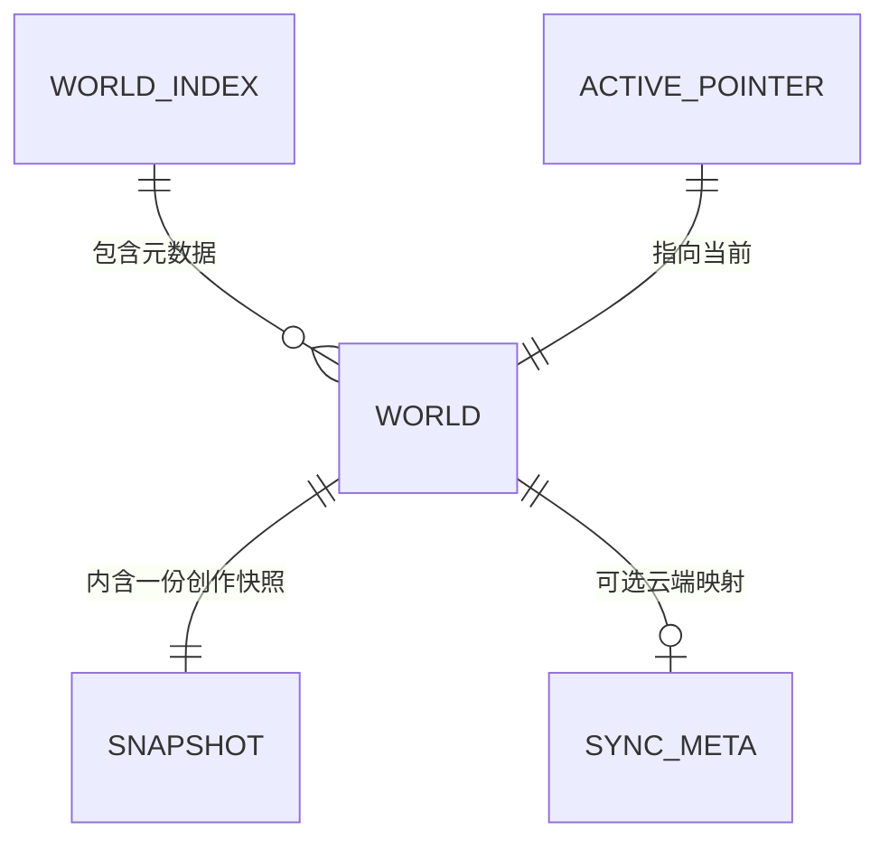

# GDD · 世界存档系统（World System）

> 版本 v0.1 · 文策渊（Vince Coyer） · 供评审，未定稿
> 关联：`CONCEPT.md`（支柱 P2/P3/P4）、`UX_SPEC.md`（界面与流程）
> 现状基线：`js/io.js` 使用单一 localStorage 键 `forgeverse_v1` 保存一份快照。本 GDD 定义其多世界替代方案。

## 1. 概述

世界存档系统负责：把用户的每一次创作，归属到一个**命名、独立、可切换、可迁移**的世界实体上。它服务三件事——

1. 让多个世界共存且互不污染（物体、地形、天气、任务、笔记、书签各自独立）。
2. 让"当前正在编辑哪一个世界"成为明确的、可持久化的状态。
3. 在本地与云端的双通道下，给出可预期、不静默覆盖的同步与冲突体验。

系统范围：世界实体定义、世界列表、活动世界指针、隔离规则、存档生命周期、同步与冲突、用户侧反馈接口。
不在范围：渲染引擎内部如何重建场景（engineering-lead 负责）、界面视觉（art-director 负责）。

## 2. 机制

### 2.1 核心对象关系



- **世界列表（WorldIndex）**：世界元数据集合，用于管理页快速渲染卡片，不含物体与地形大数据。
- **世界（World）**：一个完整世界实体，含配置 + 创作快照。
- **活动指针（ActiveWorldId）**：全局唯一，指向当前工作台加载的世界。切换到哪个世界，由它决定。

### 2.2 隔离规则（硬约束）

| 隔离对象 | 规则 |
|---|---|
| 创作内容 | `objects` / `terrain` / `terrainEdits` / `weather` / `tasks` / `note` / `bookmarks` / `mapSeed` 全部属于单一世界，不得跨世界读写 |
| 活动指针 | 全局唯一；任何时刻最多一个世界处于"已加载"状态 |
| 配置模板 | 新建时的配置项是**一次性快照**，写入新世界后与世界绑定；修改默认值不影响已存在的世界 |
| 全局设置 | 画质档位等用户偏好可全局共享，但"开局画质"作为世界配置写入快照，加载世界时按快照应用 |
| XP / 等级 | 归属到世界（每个世界独立成长），避免一个世界的进度污染另一个 |

### 2.3 存档生命周期

```
创建 → 打开 → 编辑 → 保存（自动/手动） → 切换/关闭 → [重命名 | 复制 | 删除]
                         ↓
                   云同步（可选开关）
```

- **创建**：由"新建世界配置"表单生成 World，写入索引，并写活动指针；工作台以空场景 + 配置开局。
- **打开/切换**：先保存当前世界（若脏），再写活动指针，再加载目标快照并重建场景。三步任一失败须回滚，绝不半加载（见 §5）。
- **保存**：编辑后自动保存（默认每次有效操作后防抖 1.5s）+ 手动保存入口；保存单位 = 当前活动世界的完整快照。
- **复制**：以源世界快照为底，生成新 id / 新名称 / 新时间戳，配置可继承；用于"在这个世界基础上开个变体"。
- **删除**：先二次确认，再从索引移除元数据与快照；若删除的是当前世界，须先切换到另一世界或进入空状态（见 §5.3）。

### 2.4 跨设备同步规则

- 同步单位 = **单个世界**，不是整个世界库。用户在配置里对"云同步"逐世界开关。
- 用户维度隔离：云端记录按用户 ID 归属（CloudBase RLS），不同用户世界互不可见。
- 同步字段：`config`、`snapshot`、`updatedAt`、`revision`；不同步：缩略图、纯本地 UI 状态（选中物体、相机临时位置）。
- 触发时机：保存成功后触发同步（开关开启时）；管理页进入时拉取各世界远端状态用于显示同步徽标。
- 离线行为：本地存档照常工作，同步排队；恢复网络后按队列重试，界面显示"待同步"。

### 2.5 冲突处理（用户侧体验）

- 判定依据：本地与远端的 `revision` 单调递增；revision 相同视为同一版本。
- 三种结果：

| 情形 | 用户侧表现 | 默认处理 |
|---|---|---|
| 仅本地较新 | 徽标"待同步"，保存后自动上传 | 自动，无需确认 |
| 仅远端较新 | 徽标"云端有更新"，提示"载入云端版本？" | 询问，不自动覆盖本地 |
| 双方均有改动 | 弹出冲突卡片，列出两侧的修改时间与世界名，提供三选项 | 绝不静默覆盖 |

- 三选项文案：**用本地版本** / **用云端版本** / **另存为新世界**。第三个选项保证任何创作都不丢失。
- 冲突解决后写入新 revision，并广播同步完成事件，管理页徽标回落到"已同步"。

## 3. 数据

### 3.1 World 实体（逻辑 schema）

| 字段 | 类型 | 必填 | 说明 | 示例 |
|---|---|---|---|---|
| `id` | string(uuid) | 是 | 世界唯一标识，创建后不可变 | `w_7f3a9c21` |
| `name` | string(1–24) | 是 | 世界名，列表去重 | `晨雾山谷` |
| `schemaVersion` | number | 是 | 存档结构版本，便于迁移 | `4` |
| `createdAt` | ISO8601 string | 是 | 创建时间 | `2026-10-16T09:12:00Z` |
| `updatedAt` | ISO8601 string | 是 | 最近保存时间 | `2026-10-16T10:03:21Z` |
| `openedAt` | ISO8601 string | 否 | 最近打开时间，供排序 | `2026-10-16T10:01:00Z` |
| `config` | WorldConfig | 是 | 开局配置快照，见 §3.2 | — |
| `snapshot` | WorldSnapshot | 是 | 创作内容，见 §3.3 | — |
| `sync` | SyncMeta \| null | 否 | 云端映射，见 §3.4 | — |
| `thumbnail` | dataURL \| null | 否 | 卡片缩略图；可选，缺失时显示生态占位图 | — |

### 3.2 WorldConfig（新建时一次性写入）

| 字段 | 类型 | 默认值 | 允许值 |
|---|---|---|---|
| `biome` | enum | `grass` | `grass` / `snow` / `desert` / `cyber`（见 CONCEPT §8 命名待决） |
| `seed` | number(int) | 随机 1–999999 | 1–999999 |
| `weather` | enum | `clear` | 现有 9 种天气 |
| `timeOfDay` | number(0–1) | `0.55` | 0=午夜，0.5=正午，1=午夜（对齐现有 `timeSlider/100`） |
| `quality` | enum | `standard` | `smooth` / `standard` / `hd` / `cinema` |
| `starterKit` | enum | `basic` | `empty` / `basic` / `demo` |
| `cloudSync` | boolean | `false` | — |

### 3.3 WorldSnapshot（复用并扩展现有 serialize 结构）

现有 `js/io.js` 的 `serialize()` 字段全部纳入：`worldName`、`theme`、`level`、`xp`、`time`、`terrain{seed,height,seg}`、`tasks`、`note`、`weather`、`mapSeed`、`bookmarks`、`terrainEdits`、`biomeName`、`objects[]`。
新增/改名建议：`worldName` 与 World.name 保留其一（建议以 World.name 为准，快照内不再重复存储）；`biomeName` 与 `config.biome` 统一（见 CONCEPT §8 待决项 1）。

### 3.4 SyncMeta

| 字段 | 类型 | 说明 |
|---|---|---|
| `enabled` | boolean | 该世界是否开启同步 |
| `provider` | enum | `cloudbase`（本轮唯一） |
| `remoteId` | string | 云端记录 ID |
| `revision` | number | 单调递增版本号 |
| `lastSyncedAt` | ISO8601 string \| null | 最近成功同步时间 |
| `state` | enum | `idle` / `pending` / `syncing` / `synced` / `conflict` / `error` |

### 3.5 WorldIndex 与存储键

- 存储键建议（待 engineering-lead 确认）：
  - `forgeverse.worlds.v1` → 世界索引（含所有 World 元数据 + 各世界的 snapshot 可以按 id 分键存放）
  - `forgeverse.world.<id>.v1` → 单世界完整快照（独立键，强化"独立存档"与逐个删除）
  - `forgeverse.activeWorld.v1` → 活动指针（仅存 id）
- 读取性能：管理页只读索引，不读所有快照；进入世界时按 id 读单键。

## 4. 公式

所有时间以 ISO8601 UTC 存储，展示时转本地时区。

| 名称 | 公式 | 单位/范围 | 用途 |
|---|---|---|---|
| 默认世界名 | `name = "未命名世界 " + (count(worlds) + 1)`，若冲突则 N 递增直到唯一 | 字符串 1–24 | 新建不给名字时的兜底 |
| 相对显示时间 | `Δ = now - openedAt`；`<60s`→"刚刚"；`<3600s`→"N 分钟前"；`<86400s`→"N 小时前"；`<604800s`→"N 天前"；否则 `YYYY-MM-DD` | 秒 | 卡片副标题 |
| 冲突判定 | `local.revision ≠ remote.revision` 且双方 `updatedAt > lastSyncedAt` | 布尔 | 触发冲突卡片 |
| 单世界体积估算 | `size ≈ 2048 + 800 × count(objects) + 120 × count(terrainEdits)` | 字节 | 配额提示与超限预警，系数来自当前 snapshot 平均字段长度，需实测校准 |
| 存储健康度 | `used / quota`（quota：localStorage 通常 5 MB，云端按套餐） | 0–1 | >0.8 时提示"存储将满" |

## 5. 边缘情况

1. **存储配额耗尽**：保存前估算体积，超阈值时阻止写入并弹出明确提示（"存储已满，请删除世界或导出备份后重试"），提供"导出为文件"按钮作为逃生通道。禁止静默失败。
2. **切换中途失败**：若"保存当前 → 写指针 → 加载目标"任一步失败，回滚到原活动世界，保留原场景，提示"切换失败，已留在原世界"。不允许出现"指针指向 A 但场景是 B"。
3. **删除的是当前活动世界**：删除前检查是否为活动指针所指；若是，先切换到最近打开的其他世界（若无则进入管理页空状态），再删数据。二次确认文案要写明"当前正在编辑此世界"。
4. **同名世界**：允许重名，但卡片副标题补充创建时间以便区分；重命名时提示"已有同名世界"，不阻断。
5. **旧存档迁移**：检测到 `forgeverse_v1` 且无新索引时，自动迁移为一个名为"我的第一个世界"的世界；迁移前提示用户"发现旧版存档，是否保留为新世界？"，提供"迁移 / 忽略"两选项；迁移后原键保留不删（可回滚）。
6. **离线时开启云同步**：允许开启并置为 `pending`，明确提示"当前离线，联网后将自动同步"，不阻塞本地保存。
7. **多标签页并发**：检测到活动指针被另一标签页改写时，当前页提示"该世界已在别处打开"，提供"重新载入 / 只读查看"，避免两份自动保存互相覆盖。

## 6. UI 接口

供 UX / 前端实现的事件契约（接口名建议，最终由 engineering-lead 定）：

| 编号 | 事件 | 触发 | 载荷 | 界面响应 |
|---|---|---|---|---|
| W-API-01 | `world:list` | 进入管理页 | WorldIndex[] | 渲染卡片网格/列表/时间轴 |
| W-API-02 | `world:create` | 提交新建配置 | WorldConfig | 创建世界、写指针、跳工作台 |
| W-API-03 | `world:open` | 点击世界卡片 | worldId | 保存当前 → 切指针 → 加载 → 跳工作台 |
| W-API-04 | `world:save` | 自动/手动保存 | snapshot | 更新 updatedAt、体积、同步队列 |
| W-API-05 | `world:rename` / `world:duplicate` / `world:delete` | 卡片操作 | worldId (+name) | 更新索引并刷新 |
| W-API-06 | `world:syncState` | 同步状态变化 | {worldId, state} | 更新卡片同步徽标 |
| W-API-07 | `world:conflict` | 检出冲突 | {worldId, local, remote} | 弹冲突卡片（三选项） |
| W-API-08 | `world:error` | 任一操作失败 | {code, message} | 吐司 + 状态条，必要时模态 |

## 7. 依赖

- **engineering-lead**：存储键结构、旧档迁移、CloudBase `revision`/`updatedAt` 语义、多标签页锁；确认 §3.5 键设计与 §5 边缘情况的技术可行路径。
- **art-director**：卡片选中/悬停态、同步徽标、空状态插画、冲突卡片的视觉规范（见 `UX_SPEC.md`）。
- **现有模块**：`js/io.js`（serialize 结构）、`js/state.js`（App 状态与事件总线）、`js/cloud.js`（云同步通道）。

## 8. 验收标准

| # | 验收点 | 可验证方式 |
|---|---|---|
| A1 | 可创建多个世界并全部出现在管理页 | 连建 3 个世界，列表数为 3 |
| A2 | 世界之间完全隔离 | 在世界 A 放一个方块，切到 B 确认无此方块，切回 A 确认仍在 |
| A3 | 活动指针持久化 | 刷新页面后仍停留在上次打开的世界 |
| A4 | 切换不残留 | 快速切换 5 次，场景内容与卡片显示一致 |
| A5 | 删除当前世界不崩溃 | 删除正在编辑的世界，自动切到其他世界或进入空状态 |
| A6 | 旧存档可迁移 | 构造 `forgeverse_v1` 数据，首次进入弹出迁移提示且迁移后可打开 |
| A7 | 云同步三态正确 | 断网时显示"待同步"；恢复后自动同步；构造冲突弹出三选项卡片 |
| A8 | 配额耗尽有提示 | 塞满存储后保存，出现明确提示与导出按钮，无数据丢失 |
| A9 | 冲突不静默覆盖 | 双端改动后，本地与云端内容均可通过"另存为新世界"保留 |
| A10 | 存储键结构符合设计 | 检查 localStorage，存在分世界键与独立活动指针键 |
